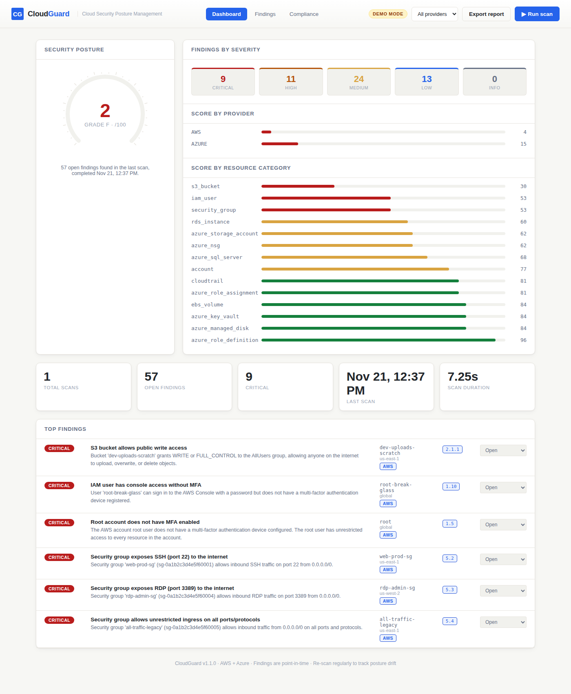

# CloudGuard

**Cloud Security Posture Management (CSPM) for AWS and Azure.**

CloudGuard scans an AWS account for common misconfigurations across S3,
IAM, EC2 Security Groups, RDS, CloudTrail, and EBS — and an Azure
subscription across Storage Accounts, Network Security Groups, RBAC role
assignments, SQL Servers, Key Vaults, and Managed Disks. It scores
overall security posture (plus a per-provider score) on a transparent
0–100 scale; maps every finding to CIS AWS Foundations Benchmark v3.0 or
CIS Microsoft Azure Foundations Benchmark v3.0.0 controls; and produces
a dashboard, JSON API, CLI, and exportable HTML/JSON reports.

It runs against real cloud accounts (read-only permissions) **or**, with
zero configuration, against bundled synthetic datasets — so the entire
tool can be evaluated end-to-end without any cloud credentials.

---

## Why this project exists

Most portfolio "security scanner" projects either (a) require a real AWS
account to demonstrate anything, or (b) are a single Python script that
prints a list of strings. CloudGuard is built the way a small security
team would actually build an internal CSPM tool: a real scanning engine
with a stable domain model, a persistence layer that tracks findings
across scans (not just point-in-time output), a REST API, a dashboard,
and a CLI — all sharing the same core logic, all covered by tests that
run in CI with no external dependencies.

## Features

- **12 scanner modules, 42 checks**: AWS — S3 buckets, IAM users/account
  settings, EC2 Security Groups, RDS instances, CloudTrail, EBS volumes
  (25 checks); Azure — Storage Accounts, Network Security Groups, RBAC
  role assignments and custom roles, SQL Servers, Key Vaults, Managed
  Disks (17 checks). Scans can target one provider or both.
- **Demo mode**: no cloud account needed. When no valid credentials are
  found for a provider, its scanners automatically fall back to a
  realistic synthetic inventory, so `git clone && run` produces real
  output immediately — for both providers.
- **Live mode**: point it at a real AWS account (via standard credential
  resolution — env vars, `~/.aws/credentials`, instance profile, SSO) or
  a real Azure subscription (service-principal env vars, `az login`,
  managed identity) and it scans for real, using the exact same check
  logic. Each provider resolves live/demo independently, so a scan can
  be live for one provider and demo for the other ("mixed" mode).
- **Explainable risk scoring**: a 0–100 posture score overall, per
  provider, and per resource category, computed from an auditable
  formula (see
  [`docs/ARCHITECTURE.md`](docs/ARCHITECTURE.md#risk-scoring-model)) —
  not a black box.
- **Compliance mapping**: every finding maps to one or more CIS AWS
  Foundations Benchmark v3.0 or CIS Microsoft Azure Foundations
  Benchmark v3.0.0 controls, with a dedicated compliance coverage view.
- **Finding lifecycle**: findings persist across scans (fingerprinted, not
  duplicated) and can be marked resolved / suppressed / risk-accepted.
- **Dashboard**: a purpose-built web UI — posture gauge, severity
  breakdown, per-provider and per-service scoring, filterable findings
  table (by severity, provider, and resource type), compliance view.
- **CLI**: run scans and generate reports without the API/dashboard at
  all — useful for CI pipelines or scheduled jobs.
- **Reports**: single-file HTML reports (print-to-PDF friendly) and JSON
  exports for integration with other tooling.
- **REST API**: fully documented via OpenAPI/Swagger at `/api/docs`.

## Quickstart

```bash
git clone <this-repo> cloudguard && cd cloudguard
./scripts/setup.sh
source .venv/bin/activate
./scripts/run.sh
```

Then open **http://localhost:8000** and click **Run scan**. No cloud
account required — CloudGuard runs in demo mode automatically, showing
findings for both AWS and Azure from its synthetic inventories. Use the
provider dropdown next to **Run scan** to scan just one provider.

To scan a real Azure subscription instead, sign in with the Azure CLI
(`az login`) or set service-principal env vars, then re-run — see
[`docs/INSTALLATION.md`](docs/INSTALLATION.md) for full setup
instructions (Docker, live-account configuration for both providers,
troubleshooting).

## Documentation

| Doc | Contents |
|---|---|
| [`docs/ARCHITECTURE.md`](docs/ARCHITECTURE.md) | System design, data flow, risk scoring model, scanner design, why key decisions were made |
| [`docs/INSTALLATION.md`](docs/INSTALLATION.md) | Full install/run instructions (local, Docker, live AWS + Azure) |
| [`docs/USAGE.md`](docs/USAGE.md) | Dashboard walkthrough, CLI reference, API reference |
| [`docs/SECURITY.md`](docs/SECURITY.md) | Required AWS IAM / Azure RBAC permissions, secrets handling, threat model, security considerations |
| [`docs/FUTURE_WORK.md`](docs/FUTURE_WORK.md) | Known limitations, assumptions, and what a v2 would add |

## Project structure

```
cloudguard/
├── backend/                 # FastAPI application
│   ├── app/
│   │   ├── core/             # config, domain model, risk engine, orchestrator
│   │   ├── scanners/         # one module per AWS/Azure service scanned
│   │   ├── compliance/       # CIS AWS + CIS Azure control mappings
│   │   ├── models/           # SQLAlchemy models + repository layer
│   │   ├── api/               # FastAPI routes + Pydantic schemas
│   │   ├── reporting/         # HTML report generator
│   │   └── main.py            # app entrypoint
│   ├── tests/                # pytest suite (69 tests)
│   ├── requirements.txt
│   └── requirements-dev.txt
├── frontend/                 # static dashboard (no build step)
│   ├── templates/index.html
│   └── static/{css,js}/
├── cli/cloudguard_cli.py     # standalone CLI
├── scripts/                  # setup / run / test / docker helper scripts
├── docs/
├── Dockerfile
├── docker-compose.yml
└── .env.example
```



## Tech stack

Python 3.12 · FastAPI · SQLAlchemy · SQLite (swappable for PostgreSQL) ·
boto3 · Azure SDK (`azure-identity`, `azure-mgmt-*`) · Pydantic v2 ·
pytest · vanilla HTML/CSS/JS dashboard (no build step, no framework) ·
Docker.

## License

MIT — see [`LICENSE`](LICENSE). Built as a portfolio/demonstration
project; see [`docs/SECURITY.md`](docs/SECURITY.md) before pointing this
at a production cloud account.
